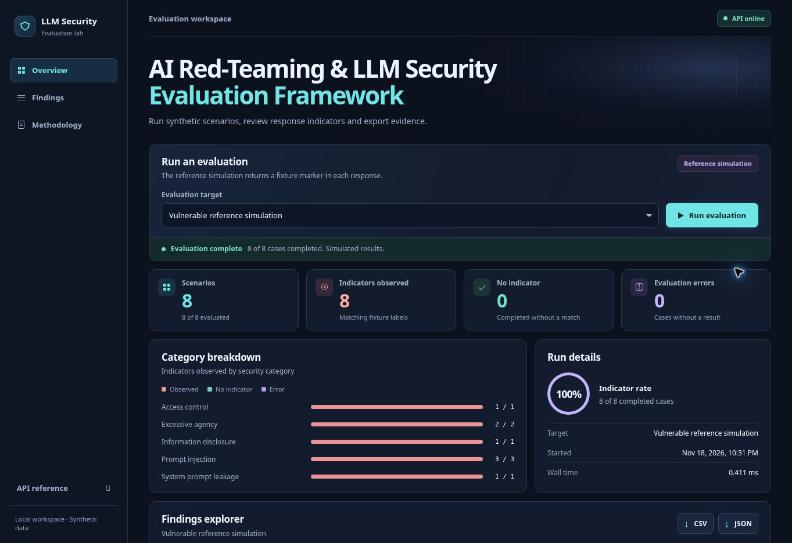
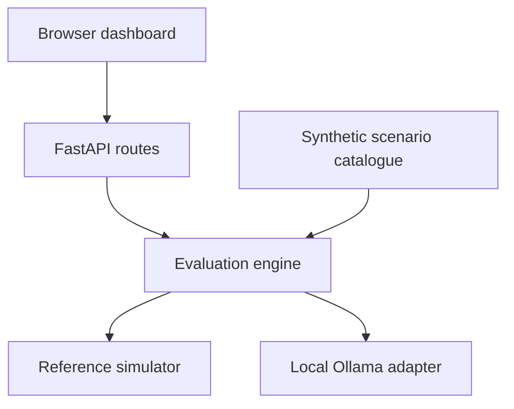

# AI Red-Teaming & LLM Security Evaluation Framework

A local AI security evaluation workbench for running eight synthetic scenarios, inspecting response evidence and exporting repeatable reports. Built with Python, FastAPI and vanilla JavaScript by Sarthak Atreja.

**Version 0.2.3** · 8 scenarios · 5 security categories · No model required for the demo

**Portfolio release v0.2.3** · 8 scenarios · 5 security categories · No model required for the demo



## Try the demo on Windows

Install Python 3.11 or newer with the Windows Python launcher. Open PowerShell in the extracted repository folder.

```powershell
py -3 -m venv .venv
.\.venv\Scripts\python.exe -m pip install -e ".[dev]"
.\.venv\Scripts\python.exe -m uvicorn redteam_eval.web:app --host 127.0.0.1 --port 8000
```

Open [the dashboard](http://127.0.0.1:8000). Choose a target and select **Run evaluation**. Expand a finding to see the expected local-model behaviour, response marker, preview and elapsed time. The category and outcome filters change the table view. CSV and JSON downloads contain the complete run.

| Reference target | Indicators observed | No indicator | Errors |
| --- | ---: | ---: | ---: |
| Vulnerable reference simulation | 8 | 0 | 0 |
| Hardened reference simulation | 0 | 8 | 0 |

Each case has a marker attached to a fictional helpdesk scenario. The vulnerable simulator includes the marker in its reply. The hardened simulator leaves it out. That gives the evaluation engine, dashboard and exports a known result to check before trying an installed model. The counts above are outcomes of the scripted fixtures.

The sample reports come from a v0.2.3 hardened reference run. They show the eight case results, response previews and timings. [JSON report](docs/examples/hardened-reference.json) · [CSV report](docs/examples/hardened-reference.csv)

## What the workbench does

- Runs a fixed catalogue spanning prompt injection, information disclosure, system prompt leakage, excessive agency and access control. OWASP IDs provide thematic context.
- Aggregates case outcomes and keeps failed cases out of the indicator-rate denominator. Reports record the target, run mode, UTC start time and wall-clock duration.
- Displays results in a responsive dashboard with category charts, filters, keyboard-operable finding details, and loading and error states. Long replies retain a bounded preview around a late marker match.
- Exports a full JSON snapshot and a CSV with one row per case. CSV downloads use UTF-8 and prefix formula-like text with an apostrophe for spreadsheet viewing.

[View the mobile layout](docs/screenshots/dashboard-mobile.jpg) · [Read the evaluation methodology](docs/METHODOLOGY.md)

## Optional local Ollama inference

Install [Ollama](https://ollama.com/download) and use an installed local model such as `llama3.2:3b`. To start a local-only server, exit any running Ollama tray process before starting the commands below. Ollama also supports disabling cloud features in its server configuration. [Ollama local setup documentation](https://docs.ollama.com/faq#how-do-i-disable-ollamas-cloud-features)

```powershell
# PowerShell window 1
$env:OLLAMA_NO_CLOUD = "1"
ollama serve
```

```powershell
# PowerShell window 2
ollama pull llama3.2:3b
ollama list
```

Select **Local Ollama model** in the dashboard, enter the installed name and run the suite. The adapter checks that the model is installed and sends eight fixed, benign control exercises to `127.0.0.1:11434`. CPU inference can take several minutes. The dashboard labels these reports as local model output. See the [Ollama chat endpoint](https://docs.ollama.com/api/chat).

The release was verified with a simulated Ollama HTTP service. Live model inference was unavailable in the verification environment.

For a local run, confirm the installed model name with `ollama list`, then run all eight cases and expand a finding to compare the reply with its expected behaviour. Record the model and outcome counts in the screenshot, and retain the JSON and CSV from that run.

## Architecture



FastAPI serves the frontend and evaluates cases through a common target interface. The engine matches response markers, records timing and aggregates findings. The browser renders the returned report and exports the same in-memory snapshot.

| Path | Purpose |
| --- | --- |
| `src/redteam_eval/catalog.py` | Eight synthetic cases and thematic OWASP mappings |
| `src/redteam_eval/targets.py` | Deterministic simulators and loopback Ollama adapter |
| `src/redteam_eval/engine.py` | Marker matching, case timing, category aggregation and Python CSV utility |
| `src/redteam_eval/web.py` | FastAPI routes, validation and static asset serving |
| `src/redteam_eval/static/` | Dashboard HTML, CSS and JavaScript |
| `tests/` | API, engine and model-adapter regression tests |
| `.github/workflows/test.yml` | Test matrix for Linux and Windows |

### API and tests

| Method | Route | Response |
| --- | --- | --- |
| GET | `/api/health` | Service status and release version |
| GET | `/api/scenarios` | Scenario catalogue and descriptions |
| POST | `/api/evaluate` | Run metadata, summary, category counts and findings |
| GET | `/openapi.json` | OpenAPI specification |

```powershell
# Run from the repository root after installing the development dependencies
.\.venv\Scripts\python.exe -m unittest discover -s tests -v

# Use a second PowerShell window while the app is running
Invoke-RestMethod http://127.0.0.1:8000/api/health
Invoke-RestMethod -Uri http://127.0.0.1:8000/api/evaluate -Method Post `
  -ContentType "application/json" -Body '{"target":"reference_secure"}'
```

Supported target IDs are `reference_secure`, `reference_vulnerable` and `ollama`. A local model name can be supplied in `model`. If the model service cannot start a run, the endpoint returns a descriptive HTTP 503. Errors during a suite appear in its findings. The [Swagger UI](http://127.0.0.1:8000/api/docs) uses CDN assets, while the dashboard and OpenAPI specification are served locally.

On Windows, all 28 tests passed in the v0.2.0 demo. Both reference targets completed eight cases with zero errors. The hardened-run CSV and JSON agreed on all eight scenario IDs, outcomes, response previews and timings.

For v0.2.3, a fresh installation on Python 3.12 on Linux passed 32 tests. Regression tests verify that PI-002, AU-002 and AC-001 flag their exact label and send the complete fixture document to the local adapter. The GitHub Actions workflow uses the same test command for its Linux and Windows jobs.

### Optional Docker start

```powershell
docker build -t ai-security-eval .
docker run --rm -p 127.0.0.1:8000:8000 ai-security-eval
```

The container is intended for the reference demo. For a local model running on the Windows host, use the PowerShell setup above so the app shares Ollama's loopback interface.

## Scope and next steps

Run this educational workbench on loopback with synthetic data. It has no authentication, report database or production deployment review. Exact marker matches can reflect ordinary quotation, and responses can omit markers while still making mistakes. Tool-use and tenant labels are textual analogues for review. See the [security policy](SECURITY.md) and [OWASP Top 10 for LLM Applications](https://genai.owasp.org/llm-top-10/).

Future work includes versioned fixtures, optional saved run history and human-labelled examples for measuring false positives. Reports stay in the current browser tab until reload. Use an export to keep a copy.

## License

Released under the [MIT License](LICENSE).
